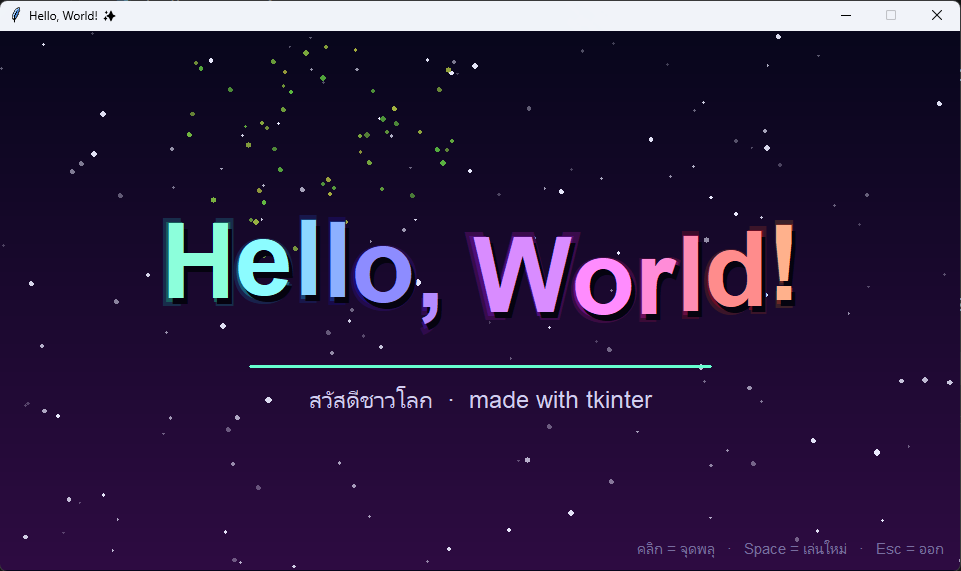

# ✨ Hello, World! — Animated (tkinter)

โปรแกรม Hello World แบบ animation เขียนด้วย Python + tkinter อยู่ในไฟล์เดียว และไม่ต้องติดตั้งไลบรารีเพิ่ม



---

## 🎬 ฟีเจอร์

| ฟีเจอร์ | รายละเอียด |
|---|---|
| **ตัวอักษรเด้งลงมา** | ตัวอักษร "Hello, World!" ตกลงมาทีละตัวแล้วเด้งตอนถึงตำแหน่ง (ease-out-back) |
| **ลอยเป็นคลื่น** | พอตัวอักษรลงครบ ตัวหนังสือจะลอยขึ้นลงเป็นลูกคลื่นต่อเนื่อง |
| **สีรุ้งไล่เฉด** | สีตัวอักษรเปลี่ยนไล่เฉดรุ้งตลอดเวลา แต่ละตัวมีเฉดเหลื่อมกันเล็กน้อย |
| **เงาและแสงเรือง** | ตัวอักษรแต่ละตัวมีเงาตกกระทบ และแสงเรือง (glow) 2 ชั้นรอบตัว |
| **ท้องฟ้าดาว** | พื้นหลังไล่สีม่วงเข้ม มีดาว 150 ดวงกระพริบและลอยเลื่อนไปทางซ้ายช้าๆ |
| **ข้อความรอง** | เส้นขีดใต้ขยายออกจากกึ่งกลาง แล้วข้อความ "สวัสดีชาวโลก" ค่อยๆ ปรากฏ |
| **พลุอัตโนมัติ** | หลังเปิดโปรแกรมประมาณ 2.6 วินาที พลุจะเริ่มจุดเองแบบสุ่มทุก 1–2 วินาที |
| **ความเร็วคงที่** | การเคลื่อนไหวคำนวณตามเวลาจริง ไม่ได้นับเฟรม จึงเร็วเท่ากันทุกเครื่อง |

---

## 🖱️ การควบคุม

| ปุ่ม / การกระทำ | ผลลัพธ์ |
|---|---|
| **คลิกเมาส์ซ้าย** | จุดพลุตรงตำแหน่งที่คลิก (คลิกรัวๆ ได้) |
| **Space** | เล่น animation ใหม่ตั้งแต่ต้น |
| **Esc** | ปิดโปรแกรม |

---

## 🚀 วิธีรัน

### 1. ตรวจว่ามี Python 3

```bash
python --version
```

ต้องเป็น Python 3.x (บางเครื่องต้องใช้คำสั่ง `python3`)

### 2. รันโปรแกรม

```bash
python hellogui.py
```

### ถ้าเจอ `No module named 'tkinter'`

- **Windows / macOS** — tkinter มากับ Python อยู่แล้ว ถ้าไม่มี ให้ติดตั้ง Python ใหม่จาก [python.org](https://www.python.org/downloads/) และติ๊กเลือก "tcl/tk and IDLE" ตอนติดตั้ง
- **Ubuntu / Debian**
  ```bash
  sudo apt install python3-tk
  ```
- **Fedora**
  ```bash
  sudo dnf install python3-tkinter
  ```
- **Arch**
  ```bash
  sudo pacman -S tk
  ```

---

## 🛠️ ปรับแต่ง

ค่าที่แก้ได้อยู่บนสุดของไฟล์ `hellogui.py`

```python
W, H = 960, 540                              # ขนาดหน้าต่าง
TEXT = "Hello, World!"                       # ข้อความหลัก
SUBTITLE = "สวัสดีชาวโลก  ·  made with tkinter"  # ข้อความรอง
BG_TOP = (8, 6, 28)                          # สีพื้นหลังด้านบน (R, G, B)
BG_BOT = (46, 12, 66)                        # สีพื้นหลังด้านล่าง (R, G, B)
```

---

## 📁 ไฟล์ในโปรเจกต์

```
.
├── hellogui.py   # โปรแกรมหลัก
├── hello.py      # โปรแกรม hello test
├── screenshot.png        # ภาพตัวอย่าง
└── README.md
```